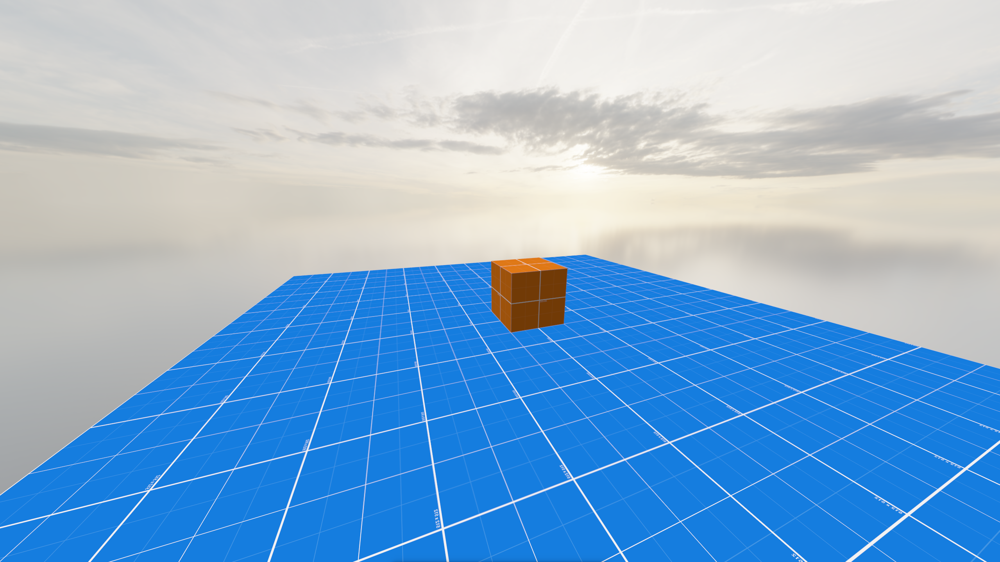

This is a framework that can render objects in 3D this is written in C++26.

# features 
- MSAA
- ECS 
- Input Handling
- Vsync
- Batching of Models & Textures

# Yet to Come 
- Collition shapes 
- Shadows
- Bloom 
- Audio 
- 2D Projection 
- P2P networking

for more info check [Archetecture](./docs/archetecture.md).
